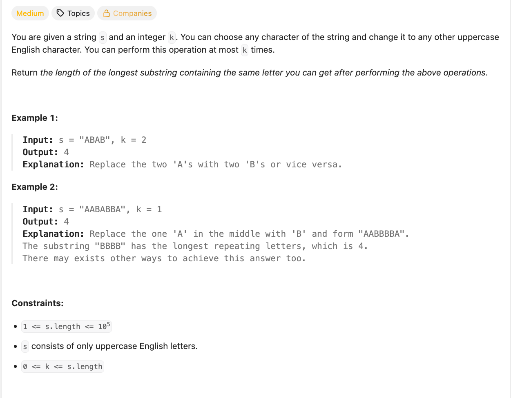

# Problem
https://leetcode.com/problems/longest-repeating-character-replacement/description



# Solution
## Rationale

The solution of the problem is based on the premise that the *longest repeating character substring*(LRCS from now on) will most likely be formed using one of the most frequent characters on `s`. This is kind of self evident, as using the other characters means that we’ll have to do a lot of transformations, and `k` is not always guaranteed to be big enough to support all those transformations.

## Algorithm

### 1. Tracking the most frequent character

Following the base premise we just established leads us to the conclusion that we must keep track of the most frequent character, or at least, the most frequent character currently as we move through the window. However, since the problem is only asking for *the length* of the LRCS, we focus on the frequency of that character. To do that we use two variables:

- `freqMap`: a frequency map or array that keeps track of the count of each character in the current window. The map will be updated as we move through the window.
- `mostFreq`: a integer that holds the max frequency we have found so far while iterating through `s`

### 2. Sliding window - expansion

A brute force solution to this problem involves using a double loop over `s`, so that for each character we scan the whole string again, leading to a $O(n^2)$ time complexity. However,…

> *Since the problem mentions to find the "**shortest/longest/min/max**" substring given some constraint, we must think of the **sliding window pattern**.*
>

Having identified a sliding window as the right approach, we need to determine how and when the window will either shrink or expand. The problem description is already hinting into how we ought to build our shrink and expansion logic. Looking for the longest or largest of anything implies that our bias should be towards expansion. We should expand the window as much as possible until some condition is met, then, we shrink. <u>The output of this algorithm will be the length of the largest window we find</u>.

We’ll use two pointers, `l` and `r` pointing to the left and right side of the window respectively. They’ll both start pointing to the same index: 0. We move `r` to expand and `l` to shrink. So we iterate over `s` using `r` as the main pointer, on every iteration `r` will increase and we need to do a couple of things:

#### a. Update `freqMap`

The frequency map maintains character frequencies of the current window, not of `s`. The reason is that the appearances of the most frequent character might not necessarily be right next to each other or even remotely close, and remember that we have a limit number of character transformations indicated by `k`. If “A” is the most frequent character, k = 2 and there are more than 2 non-A characters between appearances of A, a lot of the A’s will not be part of the solution. Let’s look at an example:

```bash
s = "AAA BCFGS AA", k = 2
```

Clearly “A” is the most frequent character in the entirety of `s`, but the last two A’s can’t be part of the solution because there are more than `k` characters between them and the rest of the A’s. In other words, we can perform at most 2 transformations so the space between appearances of the most frequent character can’t exceed `k`. Therefore, keeping ALL the appearances of characters in `s` on `freqMap` shouldn’t be done because it negates the fact that there is a limit of allowed transformations.

#### b. Update `mostFreq`

Since `freqMap` is updated at every iteration, `mostFreq` should to. We might find another character with a higher frequency.

### 3. Sliding window - shrinking

The next thing is determining if the window should be shrunk or not. As we already established, we are constrained by the amount of character transformations we can make, `k`. If we need to transform more characters than we’re allowed to, the window must shrink. We do that by increasing the `l` pointer, and updating `freqMap` by removing one count of the character `l` pointed to. This is important to maintain an accurate count of characters in the window.

**How do we know how many characters we need to transform?** Subtract the count of the most frequent character from the length of the window:

```bash
windowLen = (r - l + 1)
charsNeedToChange = windowLen - mostFreq
```

If our window length is 5, and the most frequent character *in the window* is 3, it’s clear we need to transform 2 characters. **This is why `mostFreq` always needs to reflect the most frequent character in the current window**, so we can know how many characters need changing and therefore whether we should keep on expanding the window or shrink it.

### 4. Update the max window length

On every iteration we must update the `maxLen` variable if necessary. It’s the return value of the function and holds the maximum window length we find.
